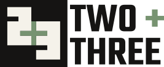

<a href="https://weare2plus3.github.io/design-system/">
  <picture>
    <source media="(prefers-color-scheme: dark)" srcset="assets/logos/two-plus-three-lockup-reversed.svg">
    
  </picture>
</a>

# Design system

The brand and UI rules for everything TWO+THREE makes: the website, apps, books and packaging. Colour, type, space, the logo, icons and components, in light and dark.

**[See the design system](https://weare2plus3.github.io/design-system/)** · [Read the guidelines](guidelines.md) · [Use it in our projects](#use-it-in-our-projects)

> software. culture. gifts. books. design.

It's public so you can see how we work. It's for TWO+THREE projects only, and all rights are reserved: see the [licence](#licence).

## What's inside

| Path | What it is |
| --- | --- |
| [`guidelines.md`](guidelines.md) | The brand book: voice, colour, type, space, elevation, states, components, logo, icons and illustration. Start here. |
| [`tokens.json`](tokens.json) | Every colour (light and dark), type style, spacing step, radius and shadow, each with a note on when to use it. |
| [`tokens.css`](tokens.css) | The tokens as CSS variables (`--paper`, `--signal`, `--space-4`…) and a class per type style (`.display`, `.body`, `.label`…). Loads Teko and Instrument Sans. |
| [`tailwind-preset.js`](tailwind-preset.js) | The tokens as a Tailwind preset: `bg-paper`, `text-ink`, `font-display`, `shadow-2`… |
| [`components/`](components) | Fourteen components, each with its guidelines and a live preview. `bundle.js` and `bundle.css` are the reference implementation (React 18); `index.d.ts` documents every prop. |
| [`react/`](react) | The Logo as an ES module for React projects. |
| [`assets/`](assets) | [Logos](assets/logos), [favicons](assets/favicons) and [social profile pictures](assets/social), each with a README on where to use them. |

## The brand in brief

- **Bold but refined.** Squared, heavy headings and one sage accent, held in check by a lot of space and quiet, square structure.
- **Two typefaces.** Teko for headings, Instrument Sans for everything you read.
- **One accent per view.** `signal`, a soft sage, is the logo's + and the one highlight on a page. `ochre` is for books, gifts and seasonal moments.
- **Square and flat.** Square corners, hairline rules, no gradients. Shadows only for things that rise above the page.
- **The logo leads only on the studio's own sites.** A separate product or project (an app, an extension, a book's site) leads with its own icon and name, and the TWO+THREE logo goes in its footer as the maker's mark, never in the header too.
- **Both themes are first-class.** Every colour has a light and a dark value.

The [guidelines](guidelines.md) have the detail.

## Use it in our projects

For TWO+THREE projects and the people working on them. Install a tagged version straight from GitHub. A project only changes when you bump the tag.

### In a JavaScript project

```json
"dependencies": {
  "@weare2plus3/design-system": "github:weare2plus3/design-system#v1.0.0"
}
```

```js
// Load the tokens once, globally
import "@weare2plus3/design-system/tokens.css";
```

```js
// tailwind.config.js
presets: [require("@weare2plus3/design-system/tailwind-preset")],
```

```jsx
// The logo, drawn from the tokens so it follows the theme
import { Logo } from "@weare2plus3/design-system/react";

<Logo height={48} />
```

### In plain HTML

```html
<link rel="stylesheet" href="https://cdn.jsdelivr.net/gh/weare2plus3/design-system@v1.0.0/tokens.css">
<link rel="stylesheet" href="https://cdn.jsdelivr.net/gh/weare2plus3/design-system@v1.0.0/components/bundle.css">
<script src="https://cdn.jsdelivr.net/npm/react@18.3.1/umd/react.production.min.js"></script>
<script src="https://cdn.jsdelivr.net/npm/react-dom@18.3.1/umd/react-dom.production.min.js"></script>
<script src="https://cdn.jsdelivr.net/gh/weare2plus3/design-system@v1.0.0/components/bundle.js"></script>
```

The components are then on `window.TwoPlusThree`. Read each component's guidelines in [`components/`](components) before using it.

## Changing it

The design system is kept on claude.ai, and this repo is its code copy. Make changes there, then re-export into this repo, so the two never drift. After a re-export:

1. Bump `version` in `package.json`: a patch for wording fixes, a minor version for new tokens, components or assets, a major version for anything renamed or removed.
2. Commit, tag it (`git tag v1.1.0`) and push the tag.
3. Bump the tag in the projects that use it.

The [site](https://weare2plus3.github.io/design-system/) rebuilds from `main` on every push. It reads the guidelines, tokens and component files directly, so it never needs editing for new content. To preview it locally, run `npm run preview` and open http://localhost:8000.

## Licence

Copyright © 2026 TWO PLUS THREE LIMITED. All rights reserved.

The design system is public so you can see it, not so you can use it. The TWO+THREE name, logo, guidelines, tokens, components and assets are for TWO+THREE's own projects and the people working on them. Using them anywhere else needs our written permission. The full terms are in [LICENSE](LICENSE).
